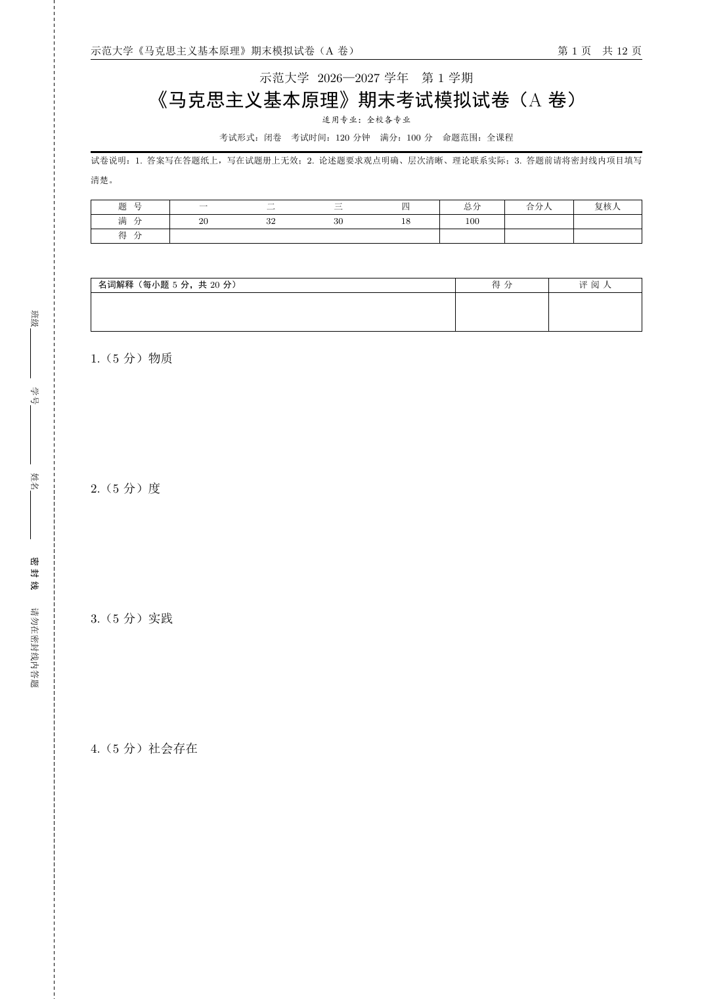
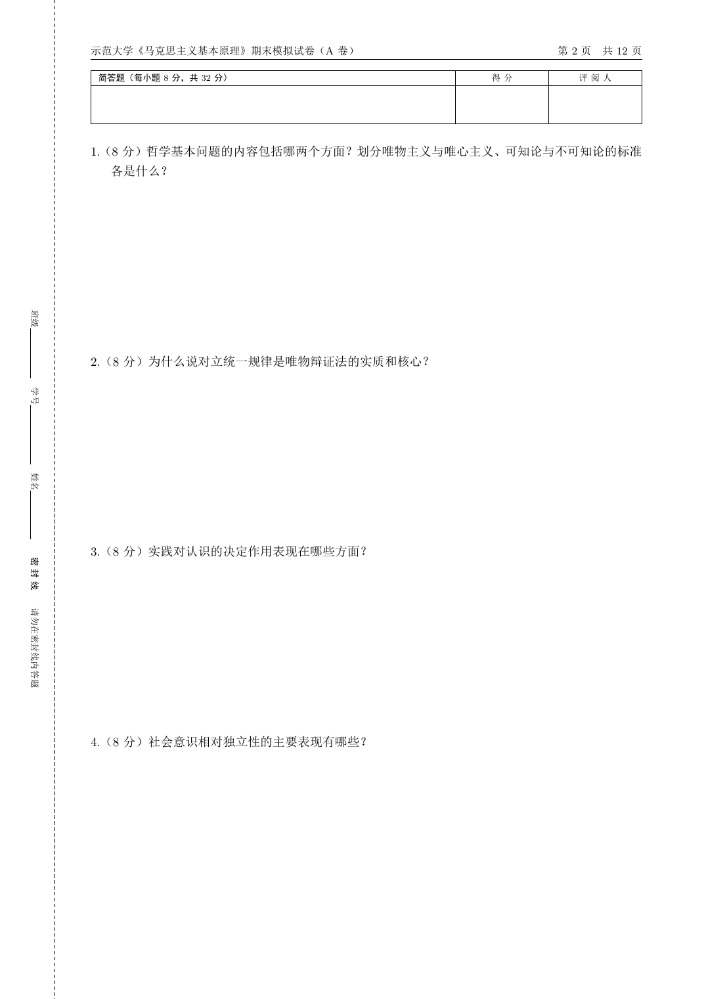
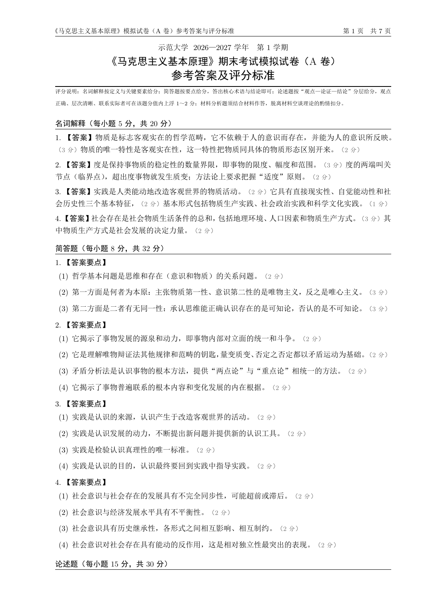

# Exam Paper Forge · 期末模拟卷工坊

> 给 AI 一份课程大纲，还你三套能直接打印的期末模拟卷 + 逐点给分的答案册。
> 版式复刻国内高校卷面：密封线、得分表、大题评分格、"共 N 页"。



---

## 为什么做这个

用 AI 复习，最没用的方式是让它"讲讲这章重点"——听完就忘。
最有效的方式是**先做一套像真题的卷子，再拿逐点给分的答案册对照**，错在哪、少写到哪个要点，一目了然。

但手动出卷太贵：排版、配分、防重复、写评分标准，一套卷要几小时。
这个项目把这条路径变成一条命令：

```bash
python scripts/init_exam.py --preset engineering --course "机电传动控制" --out ./机电传动
# 填题 → 质检 → 编译
python scripts/check_exam.py ./机电传动
python scripts/build.py ./机电传动
```

产出 `main_paper.pdf`（三套试卷）和 `main_ans.pdf`（答案册，单独成册，避免先看到答案）。

---

## 特性

**八类学科预设，一套版式**

| 预设 | 适用 | 配比 |
|---|---|---|
| `engineering` | 机械/电气/自动化/车辆 | 填空15 单选20 判断10 简答20 计算25 设计10 |
| `science` | 高数/大物/电路/信号 | 填空20 单选16 计算44 证明20 |
| `cs` | 数据结构/操作系统/网络 | 单选30 填空10 简答20 程序阅读15 算法设计25 |
| `humanities` | 思政/文学/历史/教育 | 名解20 简答32 论述30 材料分析18 |
| `law` | 各部门法 | 单选30 判断10 简答18 法条分析22 案例分析20 |
| `medical` | 基础与临床 | 单选20 多选20 名解16 简答24 病例分析20 |
| `language` | 英语/语文 | 单选20 完形10 阅读20 翻译20 写作30 |
| `business` | 经管/会计 | 单选30 判断10 简答20 计算20 案例20 |

**学校信息全参数化**：学校、学院、课程、学期、专业、考试日期、密封线开关，全在 `meta.tex` 一个文件里。留空的行不会打印。

**九条质检规则**，专治 AI 出卷的翻车点：

| 规则 | 查什么 |
|---|---|
| R01 | 得分表分值合计 = 满分 |
| R02 | 各大题声明分值合计 = 满分，且与得分表一致 |
| R03 | 填空"空数 × 每空分" = 声明分值 |
| R04 | 选择题"题数 × 每题分" = 声明分值；选项不缺项 |
| R05 | 答案与试卷逐题对齐；单选答案不指向不存在的选项 |
| R06 | A/B/C 三卷之间无重复题干 |
| R07 | 每卷都有答案册 |
| R08 | LaTeX 花括号与 `$` 配平 |
| R09 | 骨架占位符已全部替换 |

**质检器自带自测**：`python scripts/selftest.py` 会往干净卷子里注入 5 类典型错误，
验证每条规则都能抓到。抓不到就报 FAIL——这是"质检本身可信"的证据。

---

## 快速开始

### 依赖

- TeX Live 2024+（或 MiKTeX），需要 `xelatex` 与 `ctex`
- Python 3.9+（只用标准库，无需 pip 安装）

Windows 下字体自动用宋体/黑体/楷体；macOS/Linux 缺字体时自动回退 ctex 默认字体，不会编译失败。

### 三步出卷

```bash
# 1. 看预设
python scripts/init_exam.py --list

# 2. 生成骨架（题数、空数、答题区高度都算好了）
python scripts/init_exam.py \
    --preset humanities \
    --course "马克思主义基本原理" \
    --school "××大学" --college "马克思主义学院" \
    --majors "全校各专业" --time "120 分钟" \
    --out ./马原模拟卷

# 3. 填题 → 质检 → 编译
python scripts/check_exam.py ./马原模拟卷
python scripts/build.py ./马原模拟卷 --clean
```

生成的骨架里，每道题的位置、编号、答题区都排好了，你只需把 `（题干）`「（选项）」换成真实内容。

### 自定义配比

```bash
--scores 20,20,10,20,20,10     # 按预设的大题数给分值，题数自动重算
--papers 3                     # 套数（默认 3）
--no-seal                      # 不印密封线（线上练习用）
```

---

## 效果

一份完整的样例（马原，三套真实题目 + 逐点给分答案册）在 `examples/demo-mayuan/`：

| 试卷 | 答案册 |
|---|---|
|  |  |

---

## 作为 WorkBuddy Skill 使用

把整个目录放进技能目录即可：

```bash
# Windows
xcopy /E /I exam-paper-forge "%USERPROFILE%\.workbuddy\skills\exam-paper-forge"
# macOS / Linux
cp -r exam-paper-forge ~/.workbuddy/skills/
```

之后对 AI 说"给我出一套《信号与系统》的期末模拟卷"，它会自动走完
收素材 → 定结构 → 写三套卷 → 写答案册 → 质检 → 编译 的流程。

---

## 目录结构

```
exam-paper-forge/
├── SKILL.md                    技能主文件（AI 读的执行流程）
├── assets/
│   ├── style.tex               试卷版式（不用改）
│   ├── style_ans.tex           答案册版式（不用改）
│   └── meta.tex                学校/课程/学期/专业（只改这个）
├── scripts/
│   ├── init_exam.py            生成工程骨架
│   ├── check_exam.py           九条质检规则
│   ├── build.py                三遍编译 + 溢出统计
│   └── selftest.py             质检器自测
├── references/
│   ├── exam-design.md          命题方法论：双向细目表、难度分布、防撞题
│   ├── question-patterns.md    18 类题型的写法与陷阱
│   ├── latex-cookbook.md       版式宏与 6 个真实踩坑
│   └── course-profiles.md      八类学科的命题侧重
└── examples/demo-mayuan/       完整样例（三套卷 + 答案册 + PDF）
```

---

## 几个已知的坑（都已在模板里修好）

1. **页眉卷别串页** — `\juantou` 开头必须先 `\clearpage`，否则 A 卷页眉会印成"B 卷"
2. **答案册莫名空行** — `\pingfen` 里的 `\small` 改变行高，行末会多插一个 `\baselineskip`；用 `\hbox` 包死
3. **中文轻微越界** — 「、」连排导致断行点稀缺，`\emergencystretch=2em` 吸收 2–6pt 溢出
4. **"共 ?? 页"** — 必须编译三遍

细节见 `references/latex-cookbook.md`。

---

## License

MIT。题目内容由使用者自负其责；本项目只提供排版与质检工具，不提供任何院校的真题。
